# Exercise 4 — Wolt Clone

A full-stack food delivery web application inspired by Wolt, developed for the Advanced Systems Programming course.

The project combines:

* A React frontend application.
* A Node.js and Express REST API.
* A C++ TCP recommendation server from the previous exercises.
* Docker Compose for a complete local environment.

The application supports registration, login, restaurant browsing, product browsing, search, cart and checkout flow, detailed previous orders, restaurant and menu management, location-based restaurant sorting, dark/light mode, and integration with the recommendation service.

---

## Table of Contents

* [System Overview](#system-overview)
* [Main Features](#main-features)
* [Architecture](#architecture)
* [Prerequisites](#prerequisites)
* [Run the Full System with Docker](#run-the-full-system-with-docker)
* [Environment Configuration](#environment-configuration)
* [Application Usage](#application-usage)
* [API Overview](#api-overview)
* [Testing and Verification](#testing-and-verification)
* [Screenshots](#screenshots)
* [Project Structure](#project-structure)
* [Runtime Data](#runtime-data)
* [Troubleshooting](#troubleshooting)

---

## System Overview

The application is a food delivery platform in which authenticated users can:

1. Create an account and log in.
2. Browse restaurants and filter them by cuisine.
3. Search restaurants and products.
4. Open a restaurant page and view its available menu items.
5. Add products to the cart and create an order.
6. View previous orders.
7. Use browser geolocation to save their current location.
8. View nearby restaurants ordered from closest to farthest.
9. Switch between light mode and dark mode.
10. Create and manage personally owned restaurants and menu items from the Management route.

The React client does not contain restaurant, product, order, or user data as static presentation data. It receives application data from the Express API.

---

## Main Features

### Authentication and Protected Routes

* Registration form with client-side validation.
* Login form with validation and support for pressing Enter to submit.
* JWT-based authentication.
* Protected application pages for authenticated users.
* Logout support.
* Authenticated user data stored in the React authentication context.

### Restaurant Browsing

* Dynamic restaurant list loaded from the server API.
* Restaurant cards with cuisine, address, and optional distance information.
* Restaurant details page.
* Restaurant menu/product display when products are available.
* Empty state when a restaurant has no menu items.

### Search

* Search restaurants and products from the header or Search page.
* Debounced search input.
* Search results separated into restaurants and products.
* Empty state when no matching result exists.

### Categories

* Browse restaurants by cuisine category.
* Category filter updates the Nearby restaurants section.
* Available categories are derived from server-provided restaurant data.

### User and Restaurant Location

* Restaurants include latitude and longitude coordinates.
* The user can click **Use my location** to request browser location permission.
* The browser location is saved to the authenticated user through a protected API endpoint.
* Nearby restaurants are sorted by distance from the user’s saved location.
* Distances are calculated client-side with the Haversine formula.
* The application handles location permission denial, unavailable location, unsupported browsers, and request timeout gracefully.

### Cart, Checkout, and Orders

* Add available menu products to the cart.
* Update cart quantities.
* Checkout flow creates an authenticated order.
* Order status screen handles successful and failed order flows.
* Previous Orders screen shows both empty and populated states.
* Each completed order preserves restaurant and menu item snapshots so the history remains readable even if menu data changes later.
* Previous Orders cards display restaurant name, item count, menu item names, quantities, status, and total price.
* Orders are user-specific.

### Restaurant Management

* **My Restaurants** workspace for restaurants owned by the authenticated user.
* Create a restaurant with its details and an optional direct image URL.
* Search personally owned restaurants by name, cuisine, or address.
* Manage a restaurant directly from its card: edit restaurant details and manage its menu.
* Add, edit, and delete menu items with names, descriptions, prices, categories, and optional image URLs.
* New owner-created restaurants begin as **Draft** and are private until they contain at least one menu item.
* Restaurants with one or more menu items become **Published** and are visible to customers through browsing and search.
* Restaurant and menu write operations are enforced server-side so only the owner can manage them.
* Deleting a restaurant also removes its menu items.

### Recommendation Service

* The Node.js web server communicates with the C++ TCP recommendation server.
* Product views can be reported for authenticated users.
* Recommendation endpoints can return products related to user viewing history.

### Theme and Responsive UI

* Light mode and dark mode.
* Theme toggle stored in the client.
* Responsive layouts for narrow screens.
* Loading, error, and empty states across the application.

---

## Architecture

```text
Browser
  |
  | React UI / React Router / Context state
  v
React Client
  |
  | HTTP JSON requests to /api
  v
Node.js + Express Web Server
  |
  | TCP requests for recommendation-related operations
  v
C++ TCP Recommendation Server
```

### Components

| Component            | Responsibility                                                                        |
| -------------------- | ------------------------------------------------------------------------------------- |
| `client/`            | React frontend, routing, UI components, context, API calls, styles                    |
| `web-server/`        | Express REST API for users, authentication, restaurants, products, search, and orders |
| `src/`               | C++ TCP recommendation server from the previous exercises                             |
| `docker-compose.yml` | Starts the full environment with both backend services                                |
| `docs/`              | Additional documentation and screenshots                                              |

---

## Prerequisites

For the recommended full Docker run, install:

* Docker Desktop.
* Docker Compose v2, included with current Docker Desktop installations.
* A modern browser such as Chrome, Edge, or Firefox.

For optional frontend development outside Docker, install:

* Node.js 20 or later.
* npm.

For optional C++ development and tests, install:

* CMake 3.10 or later.
* A C++17-compatible compiler.
* Python 3 for the C++ end-to-end test.

---

## Run the Full System with Docker

Docker Compose starts:

* `web-server` — Express API and built React client.
* `ex2-server` — C++ TCP recommendation server.

The React production build is served by the Express server, so the complete application is available through one browser address.

### 1. Optional: create a local `.env` file

Docker Compose includes default values, so this step is optional.

```powershell
Copy-Item .env.example .env
```

Do not commit `.env` to Git.

### 2. Build and start all services

```powershell
docker compose up --build -d
```

### 3. Verify that the services are running

```powershell
docker compose ps
```

Expected services:

```text
web-server
ex2-server
```

### 4. Verify the API health endpoint

```powershell
Invoke-RestMethod http://localhost:3000/api/health
```

Expected response:

```text
status service
------ -------
ok     food-delivery-api
```

### 5. Open the application

Open the following address in the browser:

```text
http://localhost:3000
```

### 6. View live logs

```powershell
docker compose logs -f web-server ex2-server
```

Press `Ctrl+C` to stop following logs without stopping the containers.

### 7. Stop the application

```powershell
docker compose down
```

### 8. Clean restart

Use this when a clean runtime environment is needed:

```powershell
docker compose down --remove-orphans
docker compose up --build -d --force-recreate
```

> **Important:** users, orders, and other in-memory web-server data are reset when the relevant container is recreated. Create a fresh test user after a forced recreation.

---

## Environment Configuration

The repository includes `.env.example` with safe local defaults.

| Variable               |                     Default | Purpose                                                     |
| ---------------------- | --------------------------: | ----------------------------------------------------------- |
| `WEB_SERVER_HOST_PORT` |                      `3000` | Host port exposed by Docker for the web application and API |
| `WEB_SERVER_PORT`      |                      `3000` | Internal Express server port inside the container           |
| `EX2_SERVER_PORT`      |                      `8080` | Internal port of the C++ recommendation server              |
| `EX2_HOST`             |                `ex2-server` | Docker service hostname of the recommendation server        |
| `VITE_API_BASE_URL`    | `http://localhost:3000/api` | API base URL for Vite development mode; Docker uses the client `/api` default            |

### Environment-file submission note

* `.env` is ignored by Git and must not be committed to the repository.
* `.env.example` is tracked in the repository and contains safe local defaults.
* For course submission, include the required environment configuration alongside the submitted exercise only as instructed by the course staff.
* Do not commit personal, secret, or machine-specific values to Git history.

---

## Optional Frontend Development Mode

The recommended full-system command is Docker Compose.

For frontend development with Vite while the backend runs in Docker:

```powershell
docker compose up --build -d

cd client
npm install

$env:VITE_API_BASE_URL = "http://localhost:3000/api"

npm run dev
```

Then open:

```text
http://localhost:5173
```

For final testing and screenshots, use the complete Docker deployment at:

```text
http://localhost:3000
```

---

## Application Usage

### 1. Register

1. Open `/register`.
2. Enter a username, display name, password, and matching password confirmation.
3. Optionally select a profile image.
4. Click **Register**.
5. Continue to Login.

### 2. Login

1. Open `/login`.
2. Enter a valid username and password.
3. Click **Log In** or press Enter.
4. The application redirects to the Home page.

### 3. Browse Restaurants

1. Open the Home page.
2. View restaurant cards loaded from the API.
3. Click a restaurant to open its details page.
4. Browse menu products when they are available.

### 4. Filter by Category

1. On the Home page, select a cuisine category such as Italian, American, or Japanese.
2. The Nearby restaurants section updates to show only restaurants in that category.
3. Click **All** to remove the filter.

### 5. Search

1. Open the Search page or use the header search bar.
2. Type part of a restaurant or product name.
3. Review restaurant and product results.
4. Click a matching restaurant or product to continue browsing.

### 6. Save Location and Sort Nearby Restaurants

1. Log in.
2. Open the Home page.
3. Click **Use my location**.
4. Approve the browser location permission.
5. The location is stored for the authenticated user.
6. The Nearby restaurants section displays restaurants from closest to farthest.
7. Each restaurant with coordinates displays its distance in kilometers.
8. Click **Update my location** later to save a new location.

### 7. Cart and Checkout

1. Open a restaurant that has products.
2. Add one or more products to the cart.
3. Review quantities and total price.
4. Continue to Checkout.
5. Confirm the order.
6. Review the success or failure status screen.

### 8. Previous Orders

1. Open **Orders** from the navigation bar.
2. A new user sees an empty state.
3. After checkout, the created order appears with the restaurant name, item count, ordered menu items and quantities, status, and total price.
4. Order history uses a snapshot captured at checkout, so it remains readable even if restaurant or menu data changes later.

### 9. Restaurant Management

1. Log in and open **Management** from the navigation bar.
2. Select **Create Restaurant** and enter restaurant details. An image URL is optional.
3. A newly created restaurant starts as **Draft** and is visible only in **My Restaurants**.
4. Select **Manage Restaurant** on a restaurant card.
5. Use **Edit Restaurant Details** to update restaurant information.
6. Use **Manage Menu** to add, edit, or delete menu items.
7. Add the first menu item to publish the restaurant. Published restaurants appear in public browsing and search results.
8. Use the **Search your restaurants** field to filter your own restaurants by name, cuisine, or address.

### 10. Theme Toggle

1. Click **Dark** to enable dark mode.
2. Click **Light** to return to light mode.

---

## API Overview

Base URL:

```text
http://localhost:3000/api
```

### Health

| Method | Endpoint  | Description                   |
| ------ | --------- | ----------------------------- |
| `GET`  | `/health` | Returns service health status |

### Users and Authentication

| Method  | Endpoint             | Description                                             |
| ------- | -------------------- | ------------------------------------------------------- |
| `POST`  | `/users`             | Creates a user                                          |
| `GET`   | `/users/:id`         | Returns a user by ID                                    |
| `PATCH` | `/users/me/location` | Saves latitude and longitude for the authenticated user |
| `POST`  | `/tokens`            | Logs in and returns a JWT plus user information         |

### Restaurants and Products

| Method   | Endpoint                                         | Description                                                          |
| -------- | ------------------------------------------------ | -------------------------------------------------------------------- |
| `GET`    | `/restaurants`                                   | Returns public published restaurants with at least one menu item     |
| `GET`    | `/restaurants/mine`                              | Returns the authenticated user's owned restaurants and product counts |
| `POST`   | `/restaurants`                                   | Creates an owner-managed Draft restaurant                            |
| `GET`    | `/restaurants/:id`                               | Returns one public published restaurant                              |
| `PATCH`  | `/restaurants/:id`                               | Updates a restaurant owned by the authenticated user                 |
| `DELETE` | `/restaurants/:id`                               | Deletes an owned restaurant and its menu items                       |
| `GET`    | `/restaurants/:id/products`                      | Returns products for a restaurant                                    |
| `POST`   | `/restaurants/:id/products`                      | Creates a menu item for an owned restaurant                          |
| `GET`    | `/restaurants/:id/products/:pId`                 | Returns one product                                                  |
| `PATCH`  | `/restaurants/:id/products/:pId`                 | Updates a menu item for an owned restaurant                          |
| `DELETE` | `/restaurants/:id/products/:pId`                 | Deletes a menu item for an owned restaurant                          |
| `GET`    | `/restaurants/:id/products/:pId/recommendations` | Returns authenticated recommendation results                         |

> Restaurant and menu write endpoints require JWT authentication and enforce ownership on the server.

### Search and Orders

| Method   | Endpoint         | Description                                                          |
| -------- | ---------------- | -------------------------------------------------------------------- |
| `GET`    | `/search/:query` | Searches public published restaurants and their available products  |
| `POST`   | `/orders`        | Creates an authenticated order and stores display snapshots         |
| `GET`    | `/orders`        | Returns the authenticated user's detailed order history             |
| `GET`    | `/orders/:id`    | Returns one authenticated user order                                |
| `PATCH`  | `/orders/:id`    | Updates an authenticated user order                                 |
| `DELETE` | `/orders/:id`    | Deletes an authenticated user order                                 |

---

## Testing and Verification

### Build the React client

```powershell
cd client
npm install
npm run build
cd ..
```

### Check the Node.js source syntax

```powershell
node --check .\web-server\src\server.js
node --check .\web-server\src\app.js
node --check .\web-server\src\controllers\userController.js
node --check .\web-server\src\controllers\restaurantController.js
node --check .\web-server\src\controllers\orderController.js
```

### Run the API scenario checks

Start Docker Compose first, then run:

```powershell
node tests/scrum-323-create-order.test.js
node tests/scrum-324-previous-orders.test.js
node tests/scrum-325-management.test.js
```

Expected summaries:

```text
SCRUM-323 SUMMARY: 10 passed, 0 failed
SCRUM-324 SUMMARY: 7 passed, 0 failed
SCRUM-325 SUMMARY: 17 passed, 0 failed
```

### Run the C++ test suite

```powershell
cmake -S . -B build
cmake --build build
cmake --build build --target run_tests
```

### Docker smoke test

```powershell
docker compose up --build -d

docker compose ps

Invoke-RestMethod http://localhost:3000/api/health
```

---

## Screenshots

All screenshots should be saved under:

```text
docs/screenshots/
```

The screenshots below document the main application flows and the Docker deployment.

### 1. Docker Services and Health Check

Shows both Docker services running and the successful health endpoint response.

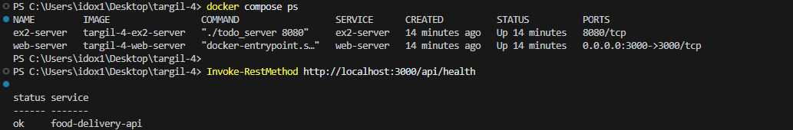

### 2. Login Screen

Shows the clean Login page before a user signs in.

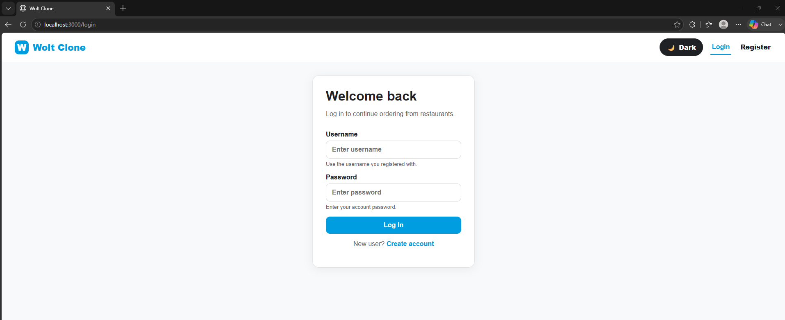

### 3. Register Screen

Shows the clean Register page and its client-side form fields.

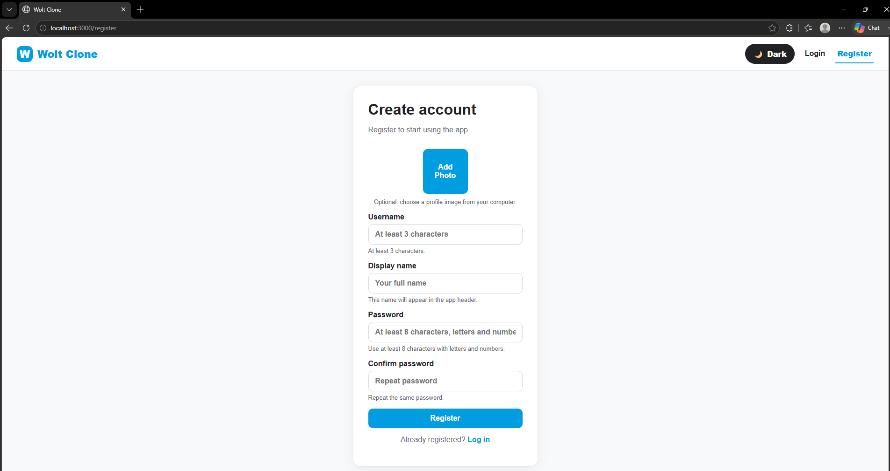

### 4. Home Page — Light Mode

Shows the authenticated Home page with the hero section, categories, restaurant cards, and navigation.

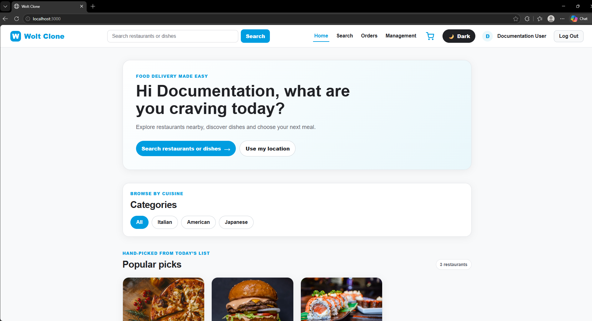

### 5. Home Page — Dark Mode

Shows that dark mode changes the application layout, cards, navigation, and colors.

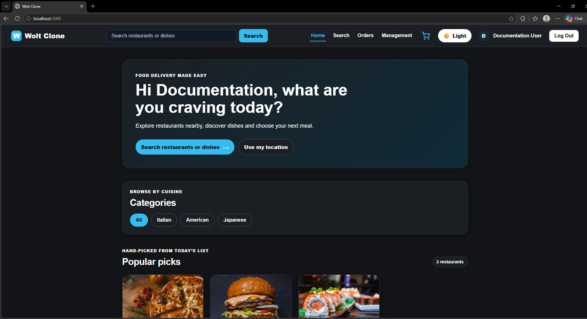

### 6. Category Filtering

Shows a selected cuisine category and the filtered Nearby restaurants section.

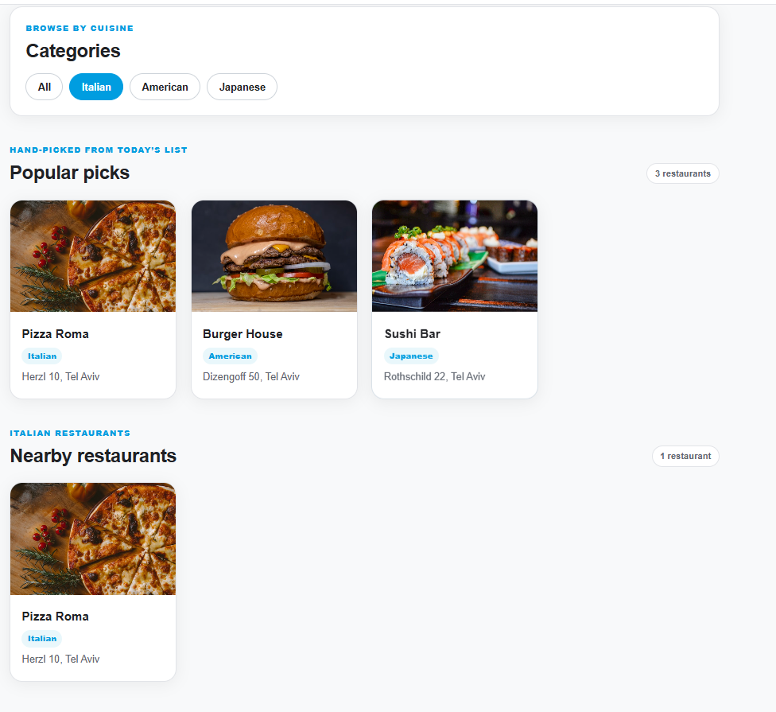

### 7. Search Results

Shows a restaurant search query and matching result.

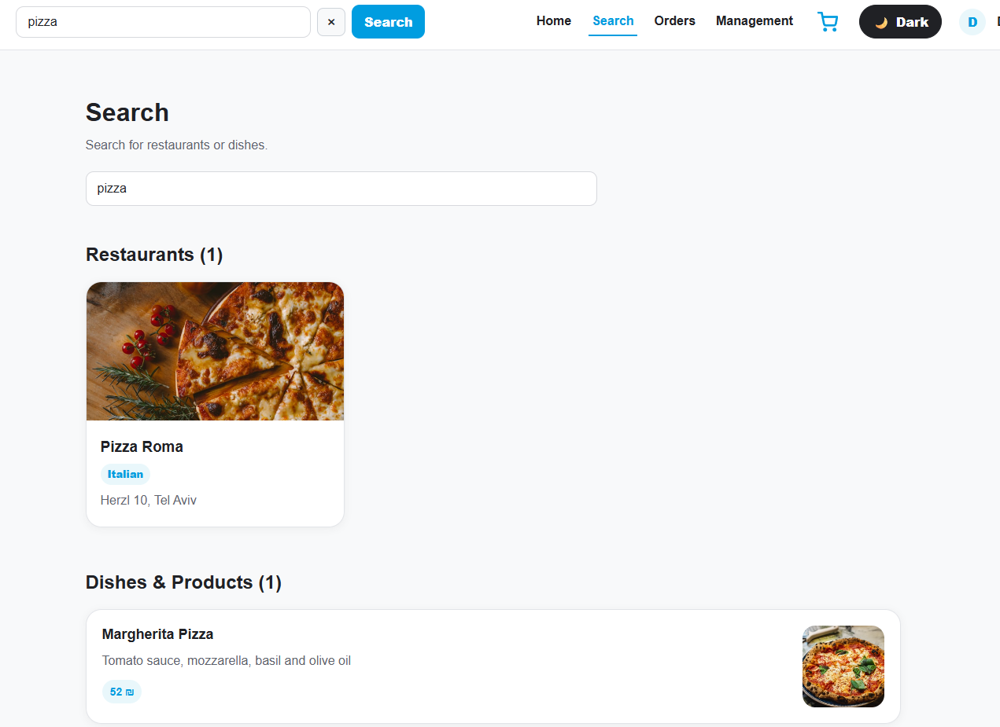

### 8. Restaurant Menu and Cart

Shows a restaurant with available products, products added to the cart, quantities, and total price.

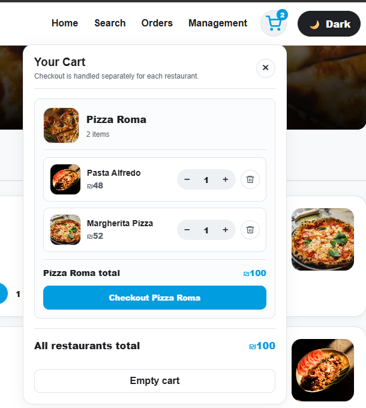

### 9. Checkout Summary

Shows the checkout page before the user confirms the order.

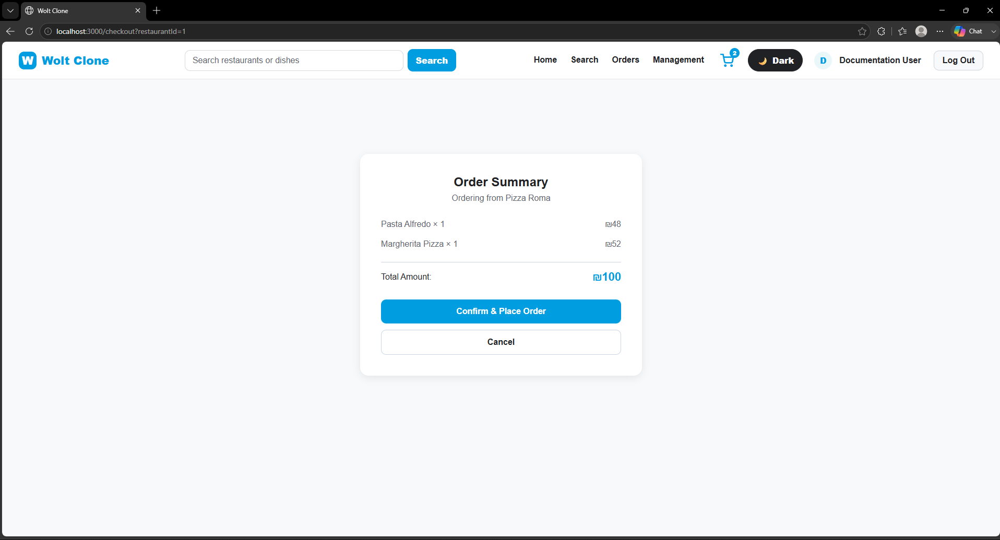

### 10. Successful Order Status

Shows the confirmation message and generated order identifier after a successful checkout.

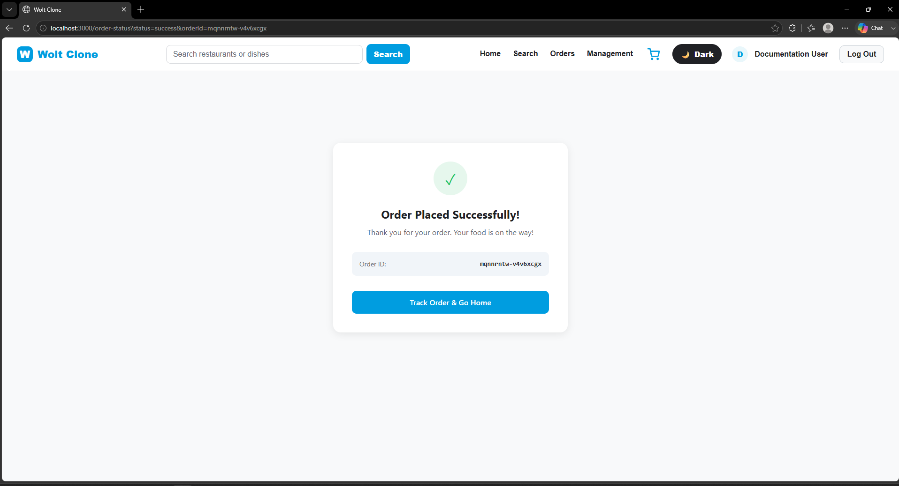

### 11. Previous Orders — Empty State

Shows the Previous Orders page for a user with no orders.

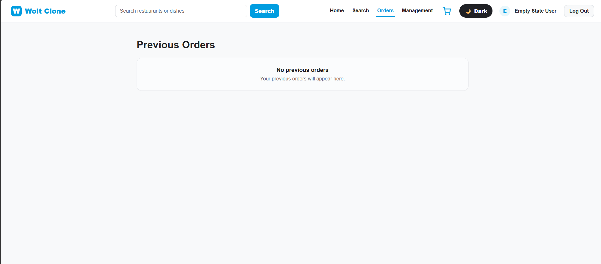

### 12. Previous Orders — Order History

Shows an existing order with restaurant name, ordered menu items and quantities, status, and total price.

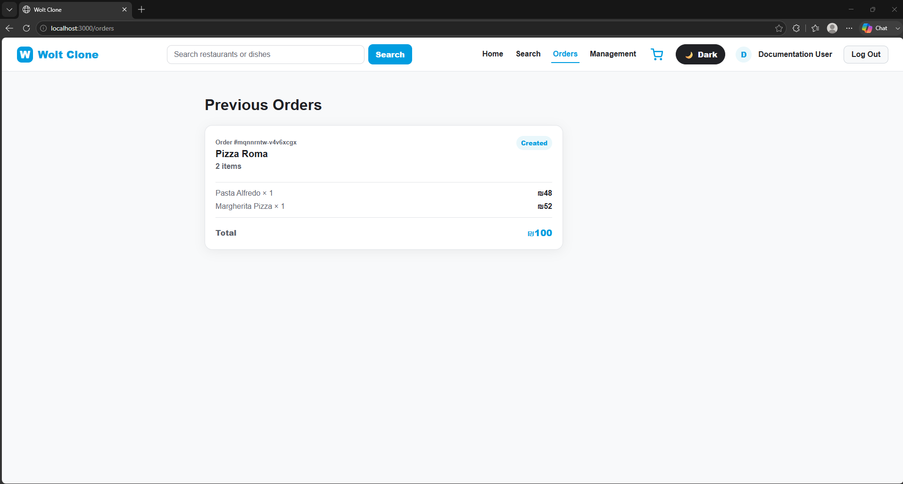

### 13. Nearby Restaurants by Saved Location

Shows restaurants sorted by distance from the user’s saved browser location, including kilometer labels.

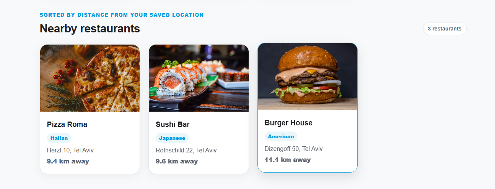

### 14. Restaurant Management

Shows the Management route with My Restaurants, owner-side search, Draft/Published status, and restaurant/menu management actions.

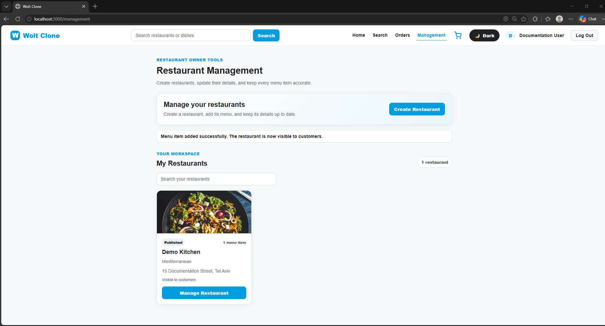

### 15. Responsive Mobile Layout

Shows the responsive Restaurant page layout on a narrow mobile viewport.

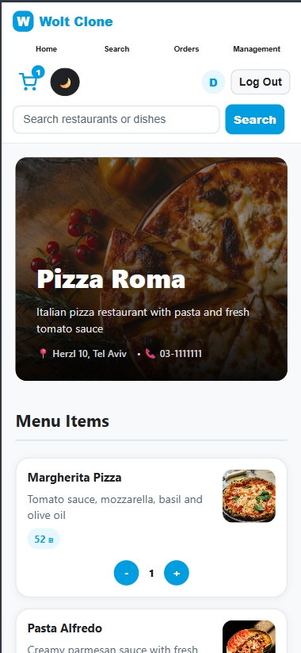

---

## Project Structure

```text
.
├── client/
│   ├── src/
│   │   ├── api/
│   │   ├── components/
│   │   ├── context/
│   │   ├── css/
│   │   ├── pages/
│   │   ├── App.jsx
│   │   └── main.jsx
│   ├── package.json
│   └── vite.config.js
├── web-server/
│   ├── src/
│   │   ├── controllers/
│   │   ├── middleware/
│   │   ├── models/
│   │   ├── repositories/
│   │   ├── routes/
│   │   ├── services/
│   │   └── utilities/
│   └── package.json
├── src/
│   └── C++ TCP recommendation server source files
├── tests/
│   └── C++ unit, integration, and end-to-end tests
├── docs/
│   ├── file-format.md
│   └── screenshots/
├── docker-compose.yml
├── Dockerfile
├── Dockerfile.webserver
├── .env.example
└── README.md
```

---

## Runtime Data

The Exercise 4 web server uses runtime in-memory repositories for users, orders, owner-created restaurants, and owner-created menu items.

This means:

* Users created during a Docker run are temporary.
* Orders created during a Docker run are temporary.
* Owner-created restaurants and menu items are temporary.
* Recreating the web-server container resets those runtime entities.
* The default restaurant and menu seed data remains available after a fresh container start.

This behavior is expected for the current exercise and does not require MongoDB or another database.

---

## Troubleshooting

### `http://localhost:3000` does not open

Check the containers:

```powershell
docker compose ps
```

Check the API:

```powershell
Invoke-RestMethod http://localhost:3000/api/health
```

Check logs:

```powershell
docker compose logs --tail=100 web-server
```

### Docker build fails because of a local Docker cache issue

Restart Docker Desktop, then run:

```powershell
docker builder prune -af
docker buildx prune -af
docker compose build --no-cache
docker compose up -d --force-recreate
```

### The user cannot log in after Docker recreation

A clean recreation resets web-server in-memory users. Register a new user and log in again.

### Browser location is denied

Use the browser site settings to allow location access for `http://localhost:3000`, then click **Use my location** again.

---

## Development Workflow

Development is managed through Jira tasks, feature branches, Pull Requests, and code review.

Typical workflow:

```text
Create Jira task
→ Create feature branch
→ Implement one focused change
→ Build and test
→ Open Pull Request
→ Code review
→ Merge into main
```

---

## Course Submission Checklist

* [ ] `.env.example` is included.
* [ ] No personal or secret `.env` file is committed to Git.
* [ ] Docker Compose builds and starts both services.
* [ ] `http://localhost:3000/api/health` returns `ok`.
* [ ] The full application opens at `http://localhost:3000`.
* [ ] README Docker instructions were tested from a clean state.
* [ ] All required screenshots were copied into `docs/screenshots/`.
* [ ] All screenshot comments were converted into rendered Markdown images.
* [ ] Login, Register, Home, Search, Restaurant, Cart, Checkout, detailed Orders, Location, Theme, and Management flows were verified.
* [ ] API scenario checks pass: SCRUM-323, SCRUM-324, and SCRUM-325.
* [ ] Final build passes with `npm run build`.
